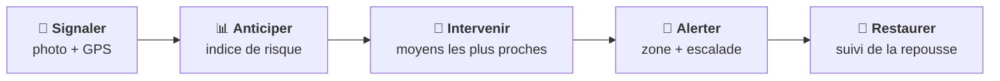
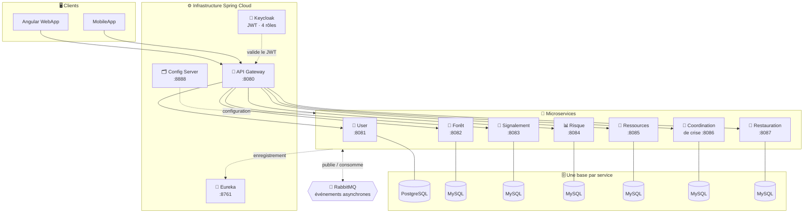
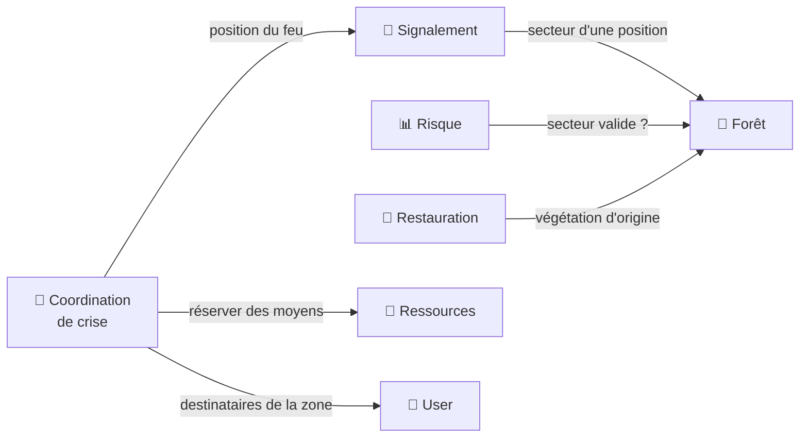
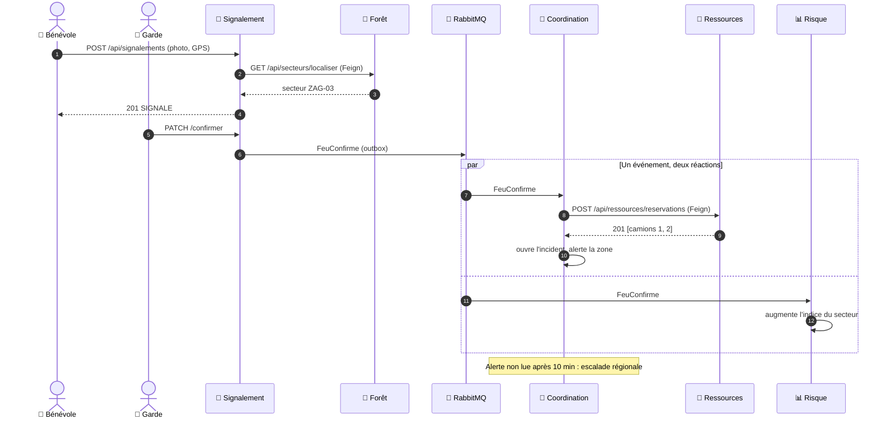
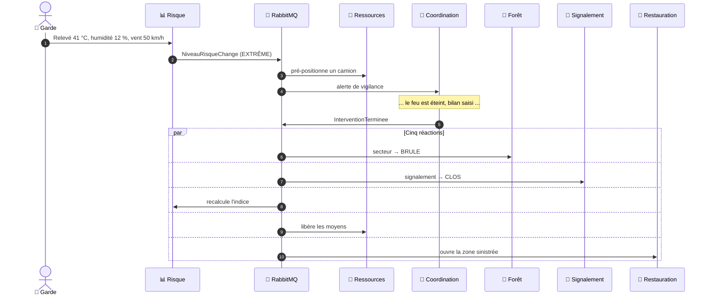
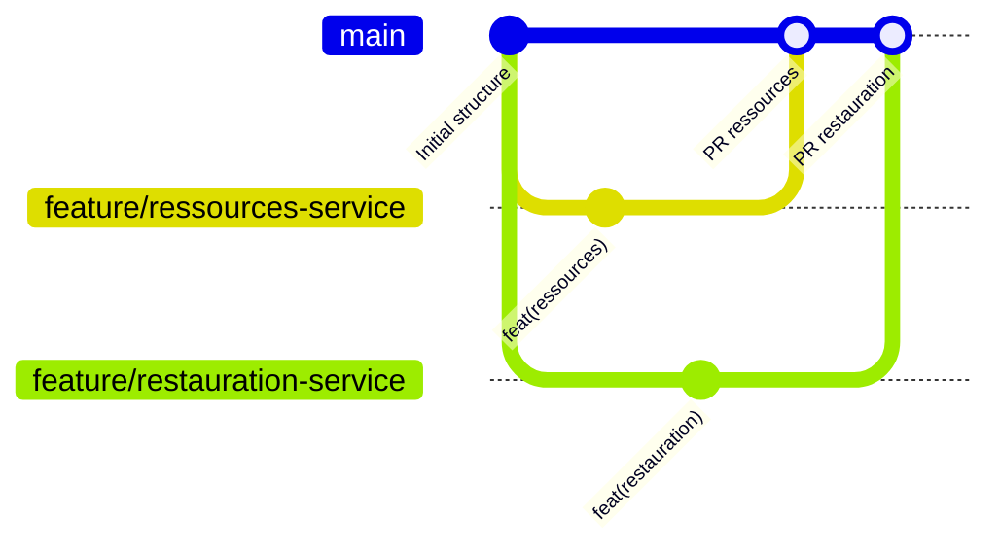

<div align="center">

# 🌲🔥 Rebois : Forest Fire Watch

### Surveillance des forêts tunisiennes et alerte incendie, en architecture microservices


**Mini-projet AWD : Applications Web Distribuées · ESPRIT · 2026-2027**

[Le sujet](#-1-le-sujet) ·
[Architecture](#%EF%B8%8F-4-architecture) ·
[Microservices](#-5-les-microservices-en-détail) ·
[Scénarios](#-7-scénarios-de-bout-en-bout) ·
[Lancer le projet](#-9-lancer-le-projet)

</div>

---

## 📑 Sommaire

| | Section |
|:-:|---|
| 1 | [🔥 Le sujet](#-1-le-sujet) |
| 2 | [👥 Acteurs et cas d'utilisation](#-2-acteurs-et-cas-dutilisation) |
| 3 | [🧑‍💻 Équipe et répartition](#-3-équipe-et-répartition) |
| 4 | [🏗️ Architecture](#%EF%B8%8F-4-architecture) |
| 5 | [🧩 Les microservices en détail](#-5-les-microservices-en-détail) |
| 6 | [🔗 Communication entre services](#-6-communication-entre-services) |
| 7 | [🎬 Scénarios de bout en bout](#-7-scénarios-de-bout-en-bout) |
| 8 | [🛠️ Technologies](#%EF%B8%8F-8-technologies) |
| 9 | [🚀 Lancer le projet](#-9-lancer-le-projet) |
| 10 | [📁 Structure du dépôt](#-10-structure-du-dépôt) |
| 11 | [🌿 Organisation Git et gestion de projet](#-11-organisation-git-et-gestion-de-projet) |
| 12 | [📅 Planning et risques](#-12-planning-et-risques) |

---

## 🔥 1. Le sujet

<table>
<tr>
<td align="center"><h2>4 800 ha</h2>de forêt brûlés en Tunisie en 2023</td>
<td align="center"><h2>438 feux</h2>pendant l'été 2023</td>
<td align="center"><h2>4 %</h2>seulement d'origine purement naturelle</td>
</tr>
</table>

### ❌ Le problème

| | Problème | Aujourd'hui |
|:-:|---|---|
| ⏱️ | **Alertes tardives** | Un départ de feu est signalé par téléphone, sans position précise ni photo. |
| 📉 | **Risque non mesuré** | Aucun indice partagé par secteur pour anticiper les jours dangereux. |
| 🚒 | **Moyens mal coordonnés** | Gardes, bénévoles et protection civile n'ont aucun outil commun. |

### ✅ Notre solution

**Forest Fire Watch** relie toute la chaîne, de la première fumée jusqu'à la repousse de la forêt :



> 💡 **Ce qui nous différencie :** les signalements du terrain et l'indice de risque **déclenchent automatiquement** l'incident, la réservation des moyens et les alertes de la zone. Personne n'a besoin de passer un coup de téléphone.

---

## 👥 2. Acteurs et cas d'utilisation

Les rôles sont gérés par **Keycloak**. Le rôle est porté par le **JWT**, vérifié à la **Gateway**, puis relu dans **chaque service**.

| Acteur | Rôle Keycloak | Cas d'utilisation |
|---|:-:|---|
| 🌲 **Garde forestier** | `GARDE` | Signaler un feu · Confirmer ou classer en fausse alerte · Saisir les relevés météo · Gérer les secteurs · Évaluer les dégâts et suivre la repousse |
| 🙋 **Bénévole** | `BENEVOLE` | Signaler une fumée ou un feu (photo, GPS) · S'abonner à une zone · Recevoir les alertes |
| 🚒 **Protection civile** | `PROTECTION_CIVILE` | Suivre un incident · Réserver des moyens · Mettre un moyen en maintenance · Clôturer avec le bilan |
| 🛡️ **Administrateur** | `ADMIN` | Gérer les unités, les forêts et les moyens · Régler les seuils de risque et les règles d'escalade |

---

## 🧑‍💻 3. Équipe et répartition

| | Microservice | Responsable | Base | Responsabilité clé |
|:-:|---|---|:-:|---|
| 👤 | **User** *(commun)* | Toute l'équipe | PostgreSQL | Profils, unités et zones, liés à Keycloak |
| 🌲 | **Forêt** | Thouraya Allagui | MySQL | Forêts, secteurs, état de la végétation |
| 📸 | **Signalement** | Ghofrane Jridi | MySQL | Départs de feu, confirmation, fausses alertes |
| 📊 | **Risque** | Souhail Machergui | MySQL | Relevés météo et indice de risque |
| 🚨 | **Coordination de crise** | Mazen Elghoul | MySQL | Incident : lutte, moyens, alertes, escalade, bilan |
| 🚒 | **Ressources** | Kmar Srarfi | MySQL | Moyens de lutte : réservation, pré-positionnement, libération |
| 🌱 | **Restauration** | Ayoub Abed | MySQL | Dégâts, plans de restauration, suivi de la repousse |

> 🤝 L'infrastructure partagée (Gateway, Eureka, Config Server, Keycloak, RabbitMQ, Docker) et le frontend sont répartis entre **tous les membres**.

---

## 🏗️ 4. Architecture



### 📐 Principes de conception

| Principe | Application dans le projet |
|---|---|
| 🎯 **Un microservice par capacité métier** | Chaque service correspond à un contexte borné : référentiel, détection, anticipation, incident, moyens, après-feu. |
| 🗄️ **Une base par service** | Aucune base n'est partagée. Un service ne lit jamais la base d'un autre : il passe par son API ou par ses événements. |
| 🔑 **Références par identifiant** | Un incident garde `ressourceId`, pas l'état du moyen, qui appartient à Ressources. Il n'y a pas de jointure entre bases. |
| ⚡ **Synchrone si la réponse est indispensable** | OpenFeign + Resilience4j (timeout, retry, circuit breaker), avec un **repli** prévu pour chaque appel. |
| 📨 **Asynchrone pour les effets de bord** | RabbitMQ, avec **outbox**, **eventId** (doublons ignorés), retry, puis **dead-letter queue**. |
| 🔐 **Sécurité en deux points** | JWT vérifié à la Gateway (signature, expiration), puis rôle relu dans chaque service. |

---

## 🧩 5. Les microservices en détail

> Cliquez sur un service pour voir ses entités, ses règles, ses endpoints et ses événements.
> Chaque service a aussi son propre `README.md` et sa documentation Swagger sur `http://localhost:<port>/swagger-ui.html`.

<details>
<summary><b>👤 User (service commun)</b> · PostgreSQL · port 8081</summary>

<br/>

**Rôle :** relie chaque compte Keycloak à un profil métier (rôle, unité, zones d'intervention). Aucun mot de passe n'est stocké : ils sont gérés par Keycloak.

| Entités | `Utilisateur` · `Unite` · `ZoneIntervention` |
|---|---|
| **Pourquoi PostgreSQL** | Contraintes `UNIQUE` (keycloakId, e-mail, zone), clés étrangères, technologie avancée imposée pour le service commun |

| Méthode | Route | Description | Codes |
|:-:|---|---|:-:|
| `POST` | `/api/users/me` | Créer mon profil | 201 · 400 · 409 |
| `GET` | `/api/users/me` | Consulter mon profil | 200 · 401 |
| `PUT` | `/api/users/me/zones` | Modifier mes zones | 200 · 400 |
| `GET` | `/api/users?gouvernorat=&role=` | Utilisateurs d'une zone | 200 · 400 |
| `POST` | `/api/unites` | Créer une unité | 201 · 400 · 409 |
| `GET` | `/api/unites/{id}` | Détail d'une unité | 200 · 404 |
| `PATCH` | `/api/users/{id}/unite` | Affecter à une unité | 200 · 404 |

📤 **Publie :** `UtilisateurCree` · 📥 **Consomme :** aucun événement (User est la source de l'identité)
</details>

<details>
<summary><b>🌲 Forêt</b> · MySQL · port 8082</summary>

<br/>

**Rôle :** référentiel des forêts tunisiennes, découpées en secteurs (GPS, rayon, végétation), avec les tours de guet et les points d'eau. Tient à jour l'**état** de chaque secteur.

| Entités | `Foret` · `Secteur` · `PointRessource` |
|---|---|
| **Règles** | Code de secteur unique · état `INTACT → BRULE → EN_RESTAURATION → INTACT` · les dégâts détaillés appartiennent à Restauration |

| Méthode | Route | Description | Codes |
|:-:|---|---|:-:|
| `GET` | `/api/forets?gouvernorat=` | Lister les forêts | 200 |
| `POST` | `/api/forets` | Créer une forêt | 201 · 400 · 409 |
| `POST` | `/api/secteurs` | Créer un secteur | 201 · 400 · 404 · 409 |
| `GET` | `/api/secteurs/{id}` | Détail d'un secteur | 200 · 404 |
| `GET` | `/api/secteurs/localiser?lat=&lng=` | Secteur d'une position GPS | 200 · 404 |
| `GET` | `/api/secteurs/{id}/points` | Tours de guet, points d'eau | 200 · 404 |
| `GET` | `/api/secteurs?etat=BRULE` | Secteurs par état | 200 · 400 |

🔁 **Appelé par :** Signalement, Risque, Restauration · N'appelle aucun service.
📤 **Publie :** `SecteurCree` · 📥 **Consomme :** `InterventionTerminee` (secteur → BRULE), `ZoneRestauree` (secteur → INTACT)
</details>

<details>
<summary><b>📸 Signalement</b> · MySQL · port 8083</summary>

<br/>

**Rôle :** permet aux gardes et aux bénévoles de signaler une fumée ou un feu (photo, GPS). Un garde le **confirme** ou le classe en **fausse alerte**.

| Entités | `Signalement` · `Photo` · `HistoriqueStatut` |
|---|---|
| **Règles** | Seul un `GARDE` confirme · transitions contrôlées (`SIGNALE → CONFIRME → CLOS`), sinon 409 · repérage des doublons proches |

| Méthode | Route | Description | Codes |
|:-:|---|---|:-:|
| `POST` | `/api/signalements` | Signaler un feu | 201 · 400 |
| `GET` | `/api/signalements?secteurId=&statut=` | Rechercher | 200 |
| `GET` | `/api/signalements/actifs` | Feux confirmés en cours | 200 |
| `GET` | `/api/signalements/{id}` | Détail et historique | 200 · 404 |
| `POST` | `/api/signalements/{id}/photos` | Ajouter une photo | 201 · 400 · 404 |
| `PATCH` | `/api/signalements/{id}/confirmer` | Confirmer le feu | 200 · 404 · 409 |
| `PATCH` | `/api/signalements/{id}/fausse-alerte` | Classer en fausse alerte | 200 · 404 · 409 |

🔁 **Appelle :** Forêt (secteur d'une position). **Repli :** statut `SECTEUR_A_VERIFIER`, pour ne jamais perdre un feu.
📤 **Publie :** `FeuConfirme` · 📥 **Consomme :** `InterventionTerminee` (signalement → CLOS)
</details>

<details>
<summary><b>📊 Risque</b> · MySQL · port 8084</summary>

<br/>

**Rôle :** collecte les relevés météo de chaque secteur et calcule un **indice de risque** (0 à 100), classé de `FAIBLE` à `EXTREME`, en tenant compte des feux récents.

| Entités | `ReleveMeteo` · `IndiceSecteur` · `HistoriqueNiveau` |
|---|---|
| **Règles** | Indice = somme pondérée (température, humidité, vent, jours sans pluie) + feux récents · seuils configurables · chaque changement de niveau est publié |

| Méthode | Route | Description | Codes |
|:-:|---|---|:-:|
| `POST` | `/api/risque/releves` | Saisir un relevé météo | 201 · 400 · 404 · 503 |
| `GET` | `/api/risque/secteurs/{id}` | Indice d'un secteur | 200 · 404 |
| `GET` | `/api/risque/carte?niveau=` | Niveaux pour la carte | 200 |
| `GET` | `/api/risque/releves?secteurId=&from=&to=` | Historique des relevés | 200 · 400 |
| `GET` | `/api/risque/secteurs/{id}/historique` | Évolution du niveau | 200 · 404 |
| `PUT` | `/api/risque/seuils` | Régler les seuils | 200 · 400 |

🔁 **Appelle :** Forêt (secteur valide). **Repli :** 503, car un relevé doit viser un secteur connu.
📤 **Publie :** `NiveauRisqueChange` · 📥 **Consomme :** `SecteurCree`, `FeuConfirme`, `InterventionTerminee`, `ZoneRestauree`
</details>

<details>
<summary><b>🚨 Coordination de crise</b> · MySQL · port 8086</summary>

<br/>

**Rôle :** gère chaque **incident** de bout en bout. Un feu confirmé ouvre un incident, qui porte la **lutte** (moyens, chronologie, bilan) et les **alertes** de la zone (ciblage, escalade).
Lutte et alertes ne sont pas deux métiers : ce sont deux actions sur le **même objet**, l'incident, avec le même cycle de vie et la même transaction.

| Entités | `Incident` · `MoyenEngage` · `EvenementChrono` · `Bilan` · `AlerteEmise` · `Escalade` · `RegleEscalade` · `Abonnement` |
|---|---|
| **Règles** | Un seul incident par feu (`UNIQUE`) · alerte non lue après **10 min**, escaladée à la caserne régionale · **SMS obligatoire** en risque EXTRÊME · pas de bilan avant l'extinction (409) |

| Méthode | Route | Description | Codes |
|:-:|---|---|:-:|
| `GET` | `/api/incidents?statut=` | Incidents en cours | 200 |
| `GET` | `/api/incidents/{id}` | Détail, chronologie, alertes | 200 · 404 |
| `POST` | `/api/incidents/{id}/moyens` | Réserver des moyens | 201 · 404 · 409 · 503 |
| `PATCH` | `/api/incidents/{id}/statut` | Passer à MAITRISE ou CLOS | 200 · 404 · 409 |
| `PUT` | `/api/incidents/{id}/bilan` | Clore avec le bilan | 200 · 400 · 409 |
| `GET` | `/api/alertes/me?lue=false` | Mes alertes | 200 |
| `PATCH` | `/api/alertes/{id}/lue` | Accuser réception | 200 · 404 · 409 |
| `POST` | `/api/abonnements` | S'abonner à une zone | 201 · 400 · 409 |

🔁 **Appelle :** Signalement (position du feu), Ressources (réservation), User (destinataires).
**Replis :** si Ressources est en panne, l'incident passe en `MOYENS_A_AFFECTER` ; si User est en panne, seuls les abonnés locaux sont prévenus.
📤 **Publie :** `InterventionTerminee` · 📥 **Consomme :** `FeuConfirme`, `NiveauRisqueChange`, `MoyensInsuffisants`, `UtilisateurCree`
</details>

<details>
<summary><b>🚒 Ressources</b> · MySQL · port 8085 · ✅ <i>projet créé et fonctionnel</i></summary>

<br/>

**Rôle :** recense les moyens de lutte de chaque caserne (camions-citernes, équipes au sol, hélicoptères, bulldozers) et gère leur **disponibilité**, leur **réservation**, leur **pré-positionnement** et leur **libération**.

| Entités | `Ressource` (position GPS, `@Version`) · `Reservation` · `PrePositionnement` · `EvenementTraite` · `OutboxEvent` |
|---|---|
| **Règles** | 📍 Les plus proches du feu d'abord (Haversine) · 🏠 une caserne garde **toujours au moins 1 camion** · ⚖️ **tout ou rien** · 🔒 **verrouillage optimiste**, avec un nouvel essai si un autre incident prend le même moyen |

| Méthode | Route | Description | Codes |
|:-:|---|---|:-:|
| `POST` | `/api/ressources` | Recenser un moyen | 201 · 400 |
| `GET` | `/api/ressources?gouvernorat=&statut=` | Moyens par zone et statut | 200 |
| `GET` | `/api/ressources/{id}` | Détail d'un moyen | 200 · 404 |
| `PATCH` | `/api/ressources/{id}/statut` | Maintenance ou retour | 200 · 404 · 409 |
| `POST` | `/api/ressources/reservations` | Réserver les plus proches | 201 · 400 · 409 |
| `GET` | `/api/ressources/reservations?incidentId=` | Moyens d'un incident | 200 |
| `DELETE` | `/api/ressources/reservations/{id}` | Libérer une réservation | 204 · 404 |

```http
POST /api/ressources/reservations
{"incidentId":5, "type":"CAMION_CITERNE", "nombre":2, "lat":36.42, "lng":10.08}

→ 201 {"incidentId":5, "ressources":[1, 2], "reservations":[...]}
→ 409 {"error":"AUCUN_MOYEN_DISPONIBLE", "message":"Demandés : 2 CAMION_CITERNE, disponibles : 1"}
```

🔁 **Appelé par :** Coordination de crise. N'appelle aucun service, pour répondre vite en urgence.
**Si Ressources est en panne :** l'incident passe en `MOYENS_A_AFFECTER`, et les événements attendent dans RabbitMQ.
📤 **Publie :** `MoyensInsuffisants` · 📥 **Consomme :** `NiveauRisqueChange` (pré-positionnement en EXTRÊME), `InterventionTerminee` (libération)
</details>

<details>
<summary><b>🌱 Restauration</b> · MySQL · port 8087</summary>

<br/>

**Rôle :** prend le relais après l'extinction. Il évalue les dégâts de chaque zone brûlée, planifie sa restauration et suit la repousse pendant des mois.

| Entités | `ZoneSinistree` · `EvaluationDegats` · `PlanRestauration` · `Action` · `SuiviRepousse` |
|---|---|
| **Règles** | Une seule zone par incident · pas de plan sans évaluation (409) · couverture végétale **≥ 70 %**, la zone passe à `RESTAUREE` |

| Méthode | Route | Description | Codes |
|:-:|---|---|:-:|
| `GET` | `/api/restauration/zones?statut=&gouvernorat=` | Zones sinistrées | 200 |
| `GET` | `/api/restauration/zones/{id}` | Détail d'une zone | 200 · 404 |
| `POST` | `/api/restauration/zones/{id}/evaluation` | Évaluer les dégâts | 201 · 400 · 409 |
| `POST` | `/api/restauration/zones/{id}/plan` | Créer le plan | 201 · 400 · 409 · 503 |
| `PATCH` | `/api/restauration/actions/{id}` | Marquer une action réalisée | 200 · 404 |
| `POST` | `/api/restauration/zones/{id}/suivis` | Ajouter un suivi de repousse | 201 · 400 · 404 |

🔁 **Appelle :** Forêt (végétation d'origine). **Repli :** le plan est créé sans végétation cible, et complété plus tard.
📤 **Publie :** `ZoneRestauree` · 📥 **Consomme :** `InterventionTerminee` (ouvre la zone sinistrée)
</details>

---

## 🔗 6. Communication entre services

### ⚡ Appels synchrones (OpenFeign + Resilience4j)



| Appelant → Appelé | Pourquoi synchrone | 🛟 Repli si l'appelé est en panne |
|---|---|---|
| Signalement → Forêt | Le secteur est nécessaire pour enregistrer le feu | `SECTEUR_A_VERIFIER` : on ne perd jamais un feu |
| Risque → Forêt | Un relevé doit viser un secteur existant | 503 |
| Restauration → Forêt | Choisir quoi replanter | Plan sans végétation cible, complété plus tard |
| Coordination → Signalement | Position et intensité du feu | Réessai |
| Coordination → Ressources | Savoir **tout de suite** quels camions partent | Incident en `MOYENS_A_AFFECTER` |
| Coordination → User | Qui prévenir dans la zone | Seuls les abonnés locaux sont prévenus |

### 📨 Événements asynchrones (RabbitMQ)

| Événement | 📤 Producteur | 📥 Consommateurs | Données clés |
|---|---|---|---|
| `UtilisateurCree` | User | Coordination de crise | userId, rôle, zones |
| `SecteurCree` | Forêt | Risque | secteurId, code, végétation |
| `FeuConfirme` | Signalement | Coordination de crise, Risque | signalementId, secteurId, GPS |
| `NiveauRisqueChange` | Risque | Ressources, Coordination de crise | secteurId, ancien et nouveau niveau |
| `InterventionTerminee` | Coordination de crise | Forêt, Signalement, Risque, Ressources, Restauration | incidentId, secteurId, surface |
| `MoyensInsuffisants` | Ressources | Coordination de crise | gouvernorat, type de moyen |
| `ZoneRestauree` | Restauration | Risque, Forêt | zoneId, secteurId, couverture |

### 🛡️ Fiabilité des événements

| Mécanisme | Ce qu'il garantit |
|---|---|
| **Outbox** | L'événement est écrit dans la **même transaction** que la donnée, puis publié. Si RabbitMQ est en panne, il n'est pas perdu. |
| **eventId** | Chaque événement traité est stocké : un **doublon est ignoré** (consommateur idempotent). |
| **Retry + dead-letter queue** | 3 essais, puis le message est mis de côté pour analyse, sans bloquer la file. |

---

## 🎬 7. Scénarios de bout en bout

### Scénario 1 : un feu confirmé



### Scénario 2 : risque extrême, puis fin d'intervention



---

## 🛠️ 8. Technologies

| Couche | Technologie | Rôle |
|---|---|---|
| 🧩 Services métier | **Spring Boot 3.3**, Java 17 | API REST, documentées avec **Swagger** (springdoc-openapi) |
| 🚪 Point d'entrée | **Spring Cloud Gateway** | Routage `lb://`, validation du JWT, CORS |
| 📇 Découverte | **Eureka** | Enregistrement et découverte des services |
| 🗂️ Configuration | **Spring Cloud Config Server** | Un fichier par service dans `config-repo/` |
| 🔐 Sécurité | **Keycloak** (OIDC) | Realm `forest-fire-watch`, 4 rôles, tokens JWT |
| 📨 Messagerie | **RabbitMQ** | Événements, outbox, retry, dead-letter queue |
| 🛟 Résilience | **Resilience4j** | Timeout, retry, circuit breaker |
| 🗄️ Données | **MySQL** · **PostgreSQL** | Une base par service |
| 🐳 Déploiement | **Docker** · Docker Compose | Images et lancement global |
| 🖥️ Frontend | **Angular** · MobileApp | Consomme les API via la Gateway |
| 🔭 Observabilité | Actuator · Zipkin | Santé des services, traçage des appels |

---

## 🚀 9. Lancer le projet

### 📋 Prérequis

| Outil | Version | Installation |
|---|---|---|
| JDK | **17** | Eclipse Temurin 17 (Java 25 n'est pas supporté par Spring Boot 3.3) |
| IDE | IntelliJ IDEA | Ouvrir le dossier `Backend/`, puis **Add as Maven Project** sur chaque `pom.xml` |
| MySQL | 8 / MariaDB | XAMPP : `root` sans mot de passe |
| PostgreSQL | 16 | Pour le service User |
| RabbitMQ | 3 | `docker run -d -p 5672:5672 -p 15672:15672 rabbitmq:3-management` |
| Keycloak | 25+ | `docker run -d -p 8180:8080 -e KEYCLOAK_ADMIN=admin -e KEYCLOAK_ADMIN_PASSWORD=admin quay.io/keycloak/keycloak start-dev` |

### ▶️ Ordre de démarrage

| # | Composant | Port | ✅ Vérification |
|:-:|---|:-:|---|
| 1 | MySQL · PostgreSQL · RabbitMQ · Keycloak | | phpMyAdmin, http://localhost:15672 |
| 2 | `config-server` | 8888 | http://localhost:8888/ressources-service/default |
| 3 | `discovery-server` | 8761 | http://localhost:8761 |
| 4 | Les microservices | 8081-8087 | Chacun apparaît **UP** dans Eureka |
| 5 | `api-gateway` | 8080 | http://localhost:8080/api/ressources |
| 6 | Frontend | 4200 | http://localhost:4200 |

> 💡 Les bases sont créées automatiquement au premier démarrage (`createDatabaseIfNotExist=true`).
> Avec un autre mot de passe MySQL, définir les variables d'environnement `DB_USER` et `DB_PASSWORD`.

### 🐳 Avec Docker

```bash
docker compose up -d
```

### 🧪 Tests

```bash
cd Backend/microservices/<service>
mvn test
```

---

## 📁 10. Structure du dépôt

```
Rebois/
├── 📂 Backend/
│   ├── 🚪 api-gateway/              Spring Cloud Gateway
│   ├── 🗂️ config-server/            Spring Cloud Config Server
│   ├── 📄 config-repo/              un <service>.yml par microservice
│   ├── 📇 discovery-server/         Eureka
│   └── 🧩 microservices/
│       ├── user-service/
│       ├── foret-service/
│       ├── signalement-service/
│       ├── risque-service/
│       ├── coordination-crise-service/
│       ├── ressources-service/
│       └── restauration-service/
├── 🖥️ Frontend/
│   ├── WebApp/                      Angular
│   └── MobileApp/
├── 📚 Documentation/
│   ├── Presentation/                support de la validation
│   └── Diagrams/
│       ├── Architecture-Technique/
│       ├── Classes-Analyse/
│       └── Classes-Domaine/
└── 📖 README.md
```

---

## 🌿 11. Organisation Git et gestion de projet

### Branches



| Branche | Usage |
|---|---|
| `main` | Version stable, modifiée uniquement par Pull Request |
| `feature/<service>` | Une branche par service ou par fonctionnalité |

**Règles :**
- ✅ Chaque Pull Request est **relue par un autre membre** avant d'être fusionnée.
- ✅ Chaque membre commite **avec son propre compte**, régulièrement.
- ✅ Messages de commit au format `type(service): description`.

| Type | Exemple |
|---|---|
| `feat` | `feat(ressources): réservation des plus proches` |
| `fix` | `fix(signalement): transition CLOS → CONFIRME refusée` |
| `test` | `test(risque): formule de l'indice` |
| `docs` | `docs: README du projet` |
| `chore` | `chore(ressources): initialisation du projet` |

### 📋 Gestion de projet : GitHub Projects

| Colonne | Contenu |
|---|---|
| 📝 À faire | Une issue par fonctionnalité, avec une étiquette par service et par séance |
| 🔨 En cours | Issue assignée à son responsable |
| 👀 En revue | Pull Request ouverte |
| ✅ Terminé | Pull Request fusionnée |

---

## 📅 12. Planning et risques

### Planning

| Séance | Objectif | État |
|:-:|---|:-:|
| **S4** | **Validation de la conception** | 🔄 |
| S5 | CRUD de chaque service, API Gateway | ⏳ |
| S6 | Appels synchrones OpenFeign | ⏳ |
| S7 | Événements RabbitMQ | ⏳ |
| S8 | Sécurité Keycloak | ⏳ |
| S9 | Docker et frontend | ⏳ |
| S10 | **Démo et soutenance** | ⏳ |

### ⚠️ Risques identifiés

| Risque | Réponse prévue |
|---|---|
| Intégration tardive des services | Contrats d'API figés dès S4, stubs WireMock |
| Chaîne d'événements difficile à déboguer | Zipkin, et eventId dans les logs |
| Configuration Keycloak complexe | Realm exporté en JSON et versionné |
| Formule de l'indice de risque trop complexe | Somme pondérée simple, seuils configurables |

---

<div align="center">

**🌲 Rebois : Forest Fire Watch**
*Détecter plus tôt, intervenir plus vite, restaurer durablement.*

ESPRIT · Module AWD · 2026-2027

</div>
